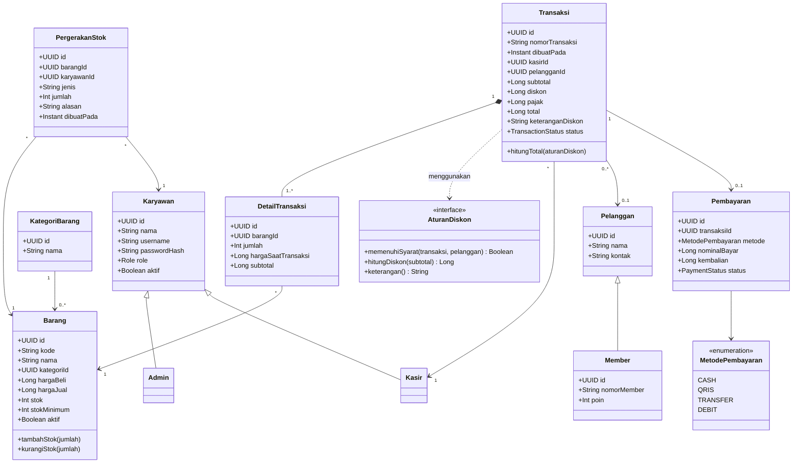

# Class Diagram — rancangan awal

## Catatan desain
- Diagram ini adalah rancangan konseptual untuk disepakati, bukan implementasi final.
- Role Admin/Kasir dapat berupa enum alih-alih subclass jika perilakunya tidak berbeda. Tim harus memilih satu pola dan konsisten.
- Gunakan tipe uang integer dalam satuan rupiah untuk menghindari error floating point.
- UUID adalah rekomendasi untuk ID internal.
- Hindari inheritance yang tidak dibutuhkan hanya demi menunjukkan konsep OOP.
