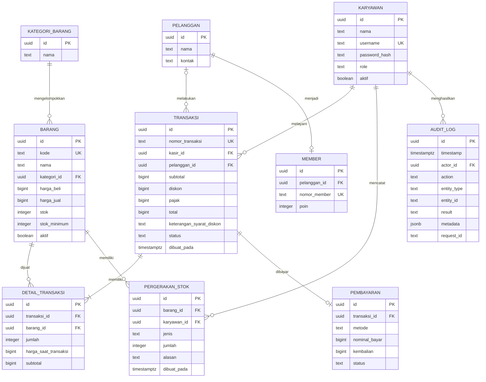

# ERD PostgreSQL — rancangan awal

## Audit Log (PostgreSQL `JSONB`)
Tabel `audit_logs` disimpan langsung di PostgreSQL menggunakan kolom `metadata` bertipe `JSONB` agar ringan (tanpa perlu container MongoDB terpisah) namun tetap fleksibel menyimpan struktur objek event:
- `id` (`UUID`)
- `timestamp` (`TIMESTAMPTZ`)
- `actor_id` (`UUID`, nullable)
- `action` (`TEXT`)
- `entity_type` (`TEXT`)
- `entity_id` (`TEXT`)
- `result` (`TEXT`)
- `metadata` (`JSONB`)
- `request_id` (`TEXT`)

Jangan menyimpan password, token, atau informasi rahasia di audit log.
